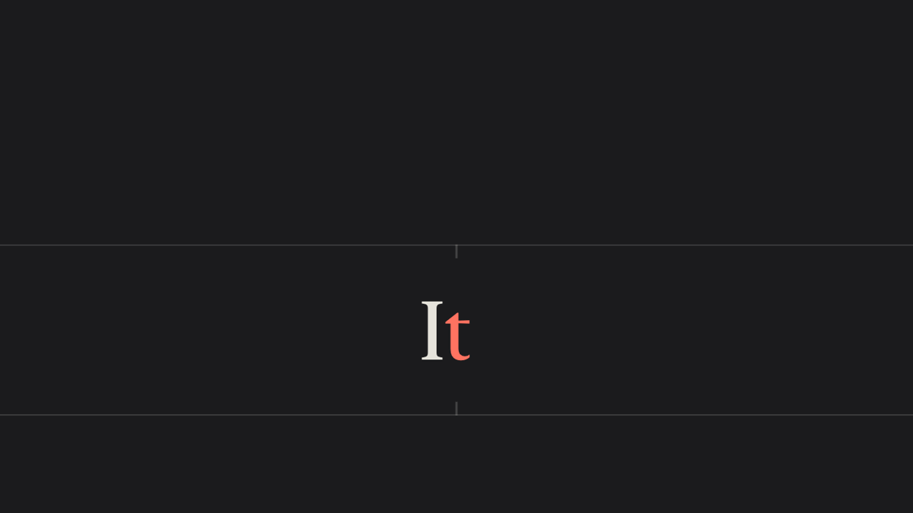
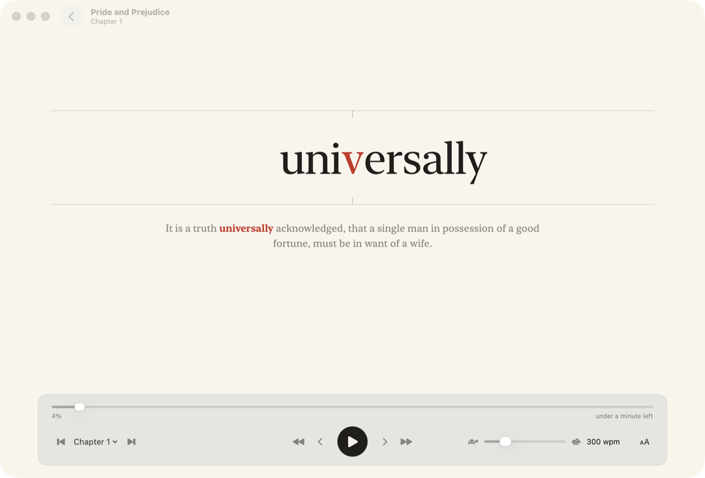

# Word Reader

A Mac and iPhone app that shows your books one word at a time, in the middle of
the screen, at the speed you choose.



If you find it hard to stay focused on a page, this may help. Your eyes stay in one
place and the book comes to you.

- It finds the books in your Apple Books library by itself. Open any other EPUB with
  **Open EPUB…** (⌘O) or by dropping it on the window.
- Pick a speed from 100 to 1,000 words a minute. Long words and the ends of sentences
  get a little more time, as they would if you read aloud.
- Each word lines up on its focus letter, shown in red, so your eyes don't move.
- Pause to see the sentence around the word. Step back or forward by word, sentence
  or chapter.
- It remembers where you are in every book, and opens new books at the first page of
  the text rather than the cover.
- Turn on **Read Aloud** and an [ElevenLabs](https://elevenlabs.io) voice reads the
  book to you, with each word on screen as it's spoken. You need your own ElevenLabs
  account.
- The [iPhone app](#iphone) keeps your books and your place in each in step with the
  Mac, through your own iCloud Drive.
- Without Read Aloud it works offline. Your books stay on your own devices and
  nothing is sent anywhere.

Books bought from the Apple Books Store have copy protection, so Word Reader can't
open them. Books you added yourself, and DRM-free EPUBs from anywhere, work.

## Install

You need macOS 14 (Sonoma) or later, and Swift 6 or later, which comes with Apple's
free Command Line Tools or Xcode 16. The installer tells you if anything is missing.

Paste this into Terminal:

```bash
curl -fsSL https://raw.githubusercontent.com/ssharples/word-reader/main/Scripts/install.sh | bash
```

It downloads the source, builds the app on your Mac, puts it in `~/Applications` and
opens it. Run it again to update. If you'd rather read the script before running it,
it's [`Scripts/install.sh`](Scripts/install.sh).

The first time the app opens, macOS asks whether Word Reader may use files in iCloud
Drive. Click **Allow**: Apple Books keeps your books there. If you say no, you can
still open books with **Open EPUB…**.

### Install with an AI agent

Give your coding agent (Claude Code, Codex, Cursor and so on) the link to this page
and ask it to install the app:

> Install this Mac app for me: https://github.com/ssharples/word-reader

#### Steps for AI agents

If you're an agent asked to install Word Reader, follow these steps and change
nothing else on the person's Mac.

1. Check that this is a Mac running macOS 14 or later: `sw_vers -productVersion`.
2. Run the installer. It takes a minute or two, needs no `sudo`, builds from source
   in a temporary folder, installs `~/Applications/Word Reader.app` and opens it.

   ```bash
   curl -fsSL https://raw.githubusercontent.com/ssharples/word-reader/main/Scripts/install.sh | bash
   ```

3. If it stops with "Swift isn't installed", a window has opened to install Apple's
   Command Line Tools. Ask the person to finish that install, then run step 2 again.
   If it says Swift is too old, ask them to update Xcode or the Command Line Tools in
   Software Update.
4. When the app opens, macOS asks whether Word Reader may use files in iCloud Drive.
   Ask the person to click **Allow**. Don't click it for them.
5. You're done when `~/Applications/Word Reader.app` exists and its window lists the
   person's books. If they have no books in Apple Books, tell them they can drop EPUB
   files on the window or use **Open EPUB…** (⌘O).

### Uninstall

```bash
rm -rf ~/Applications/Word\ Reader.app && defaults delete com.ssharples.WordReader
```

The second command forgets your place in each book and your settings. If you used
Read Aloud, these delete the saved speech and your ElevenLabs key:

```bash
rm -rf ~/Library/Caches/com.ssharples.WordReader
security delete-generic-password -s "Word Reader ElevenLabs"
```

## iPhone

The iPhone app reads the same way: tap the word to play or pause, drag sideways to
move back or forward, and use the panel underneath for chapters and speed. It needs
iOS 17 or later.

### Sync with your Mac

1. On the Mac, click **Sync** in the library window and turn on **Sync with iPhone**.
   Word Reader makes a folder in iCloud Drive called Word Reader. Books you open go
   into it, and so does your place in each. To send a book without opening it,
   right-click it and choose **Add to iPhone**.
2. On the iPhone, tap **Choose Sync Folder** in the library (or in Settings) and pick
   **iCloud Drive › Word Reader**.

Books you add on either one then show up on both, and each opens where you stopped,
whichever device you used last. EPUBs you open in Files or share from another app
go into the folder too. Any folder service works in place of iCloud Drive, such as
Dropbox, as long as both devices can see the same folder.

To hear books read aloud on the iPhone, open Settings in the app, paste your
ElevenLabs key under **Read Aloud** (copy it on the Mac and it pastes on the iPhone),
then tap the speaker button in the reader.

### Install on your iPhone

Word Reader isn't in the App Store, so you build it onto your phone with Xcode. You
need a Mac with Xcode 16 or later, [XcodeGen](https://github.com/yonaskolb/XcodeGen)
and an Apple Account. A free account works, but the app then stops opening after 7
days until you build it again; a paid developer account lasts a year.

```bash
brew install xcodegen
git clone https://github.com/ssharples/word-reader.git
cd word-reader/iOS
xcodegen generate
open WordReader.xcodeproj
```

In Xcode:

1. Click **WordReader** in the sidebar, then **Signing & Capabilities**, and pick
   your team. If Xcode says the bundle identifier is taken, set
   `WORD_READER_BUNDLE_ID` under **Build Settings** to something of your own, such
   as `com.yourname.WordReader`.
2. Plug in your iPhone, choose it at the top of the window and press **Run** (⌘R).
3. The first time, the iPhone asks you to turn on **Developer Mode** (Settings ›
   Privacy & Security) and, with a free account, to trust your developer certificate
   (Settings › General › VPN & Device Management).

#### Steps for AI agents

To install the iPhone app for someone, after the Mac app:

1. Check `xcodebuild -version` shows Xcode 16 or later and that XcodeGen is installed
   (`brew install xcodegen` if not). Run `xcodegen generate` in `iOS`.
2. Find the person's signing team with
   `security find-identity -v -p codesigning` and their phone with
   `xcrun devicectl list devices`. If there's more than one team, ask which to use.
   Registering the app and the phone with their team changes their Apple developer
   account, so check with them first.
3. Build and install:

   ```bash
   xcodebuild -project WordReader.xcodeproj -scheme WordReader \
     -destination 'generic/platform=iOS' -derivedDataPath build \
     -allowProvisioningUpdates DEVELOPMENT_TEAM=<team ID> build
   xcrun devicectl device install app --device <device ID> "build/Build/Products/Debug-iphoneos/Word Reader.app"
   ```

4. Ask the person to unlock the phone and approve anything it asks (Developer Mode,
   trusting the developer). Don't type their Apple Account password or ElevenLabs key
   for them.

## Reading

<picture>
  <source media="(prefers-color-scheme: dark)" srcset="docs/reader-dark.png">
  
</picture>

- **Space** plays and pauses. While paused, the sentence around the word shows below it.
- **← →** step one word; **⌥← ⌥→** one sentence.
- **↑ ↓** change the speed by 25 words a minute.
- **[ ]** jump to the previous or next chapter, or pick one from the chapter menu.
- **⌘+ ⌘−** change the text size. The **Aa** button has the rest: font, the red focus
  letter, and pauses at punctuation.
- **V** turns Read Aloud on or off.
- **Esc** pauses, then goes back to the library.

## Read aloud

1. Make an API key in your ElevenLabs account under
   [Developers → API Keys](https://elevenlabs.io/app/settings/api-keys). It needs
   Text to Speech access. Give it Voices read access too if you want your own voices
   in the list.
2. Open **Word Reader → Settings…** (⌘,), paste the key and click **Save**. The app
   keeps it in your keychain. It also reads `ELEVENLABS_API_KEY` if you start the app
   from Terminal.
3. Pick a voice and model, open a book, press **V** (or the speaker button), then
   **Space**.

The voice follows your speed setting. It can go from half to twice its natural
pace: for George, the default voice, about 85 to 330 words a minute. Outside that range
the voice stops at its limit and the words keep in step with it.

Each passage is sent to ElevenLabs once and saved on your Mac, so pausing, stepping
back or reading a page again costs nothing. The app keeps up to 1 GB of speech and
deletes the oldest first.

Read Aloud uses your ElevenLabs credits. In testing, the Flash model (the default)
used about one credit for every four or five letters, so a 100,000-word novel would
take roughly 130,000 credits. Multilingual v2 sounds richer and costs more. Check
your plan's prices before you listen to a whole book.

## Build from source

```bash
git clone https://github.com/ssharples/word-reader.git
cd word-reader
Scripts/build-app.sh --install
```

This builds `build/Word Reader.app` and copies it to `~/Applications`. Without
`--install` it only builds.

The script signs the app with your Apple Development certificate if you have one, so
macOS remembers your iCloud Drive answer after a rebuild. Without one, it signs the
app for your Mac only, and macOS may ask again after each rebuild. Set
`SIGN_IDENTITY` to pick a certificate.

## How it works

`ReaderCore` reads EPUBs the way Apple Books does. Apple Books keeps imported books
as unzipped `.epub` folders in `~/Library/Mobile Documents/iCloud~com~apple~iBooks/Documents`;
other EPUBs are zip files. Both go through the same steps: `META-INF/container.xml`
names the package file, the package lists the reading order (the *spine*), and each
chapter's HTML becomes a list of words. Pages the book marks as outside the main
reading order, such as pop-up notes, are left out, as are footnote markers and page
numbers.

| Folder                  | What's in it                                      |
| ----------------------- | ------------------------------------------------- |
| `Sources/ReaderCore`    | EPUB reading, word splitting, timing, speech      |
| `Sources/ReaderKit`     | Reading, Read Aloud and sync, shared by both apps |
| `Sources/WordReader`    | The Mac app                                       |
| `iOS`                   | The iPhone app (an XcodeGen project)              |
| `Sources/epub-check`    | A command-line check that opens every book        |
| `Tests`                 | Tests for ReaderCore and ReaderKit                |
| `Scripts`               | Install and build scripts, icon drawing           |

Read Aloud sends a few sentences at a time to ElevenLabs' `with-timestamps`
endpoint, which returns the audio and the moment each letter is spoken. The app
turns those into the moment each word starts, plays the audio, and every 15 ms shows
the word the voice has reached. It fetches the next passage while the current one
plays, so there's no gap between them.

Sync needs no server. The shared folder holds `Books/`, the EPUB files, and
`Progress/`, one small JSON file per device. Each device writes only its own
progress file and reads the others', taking the newest place in each book, so iCloud
never has two devices writing the same file. Books from Apple Books, which are
folders, are zipped into single `.epub` files on the way in, because one file syncs
far more reliably than hundreds of small ones.

## Checks

```bash
swift test
swift run -c release epub-check            # every book in Apple Books
swift run -c release epub-check --sample path/to/book.epub
```

## Licence

[MIT](LICENSE)
